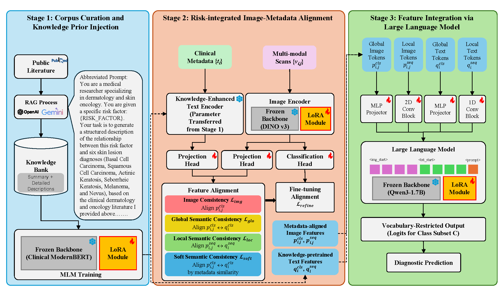

# PRIMA: Pre-Training with Risk-Integrated Image--Metadata Alignment for Medical Diagnosis with LLM-Based Feature Aggregation

PRIMA is a three-stage framework for report-scarce, metadata-rich medical diagnosis. It injects risk-disease priors into a clinical text encoder, aligns image features with metadata-derived semantic anchors, and uses a vocabulary-restricted LLM classifier to aggregate aligned multimodal features.

> Preprint: [arXiv:2602.23297](https://arxiv.org/abs/2602.23297)

**Authors:** Yiqing Wang, Chunming He, Ziyun Yang, Maria Woodward, Ming-Chen Lu, Leslie Niziol, Mercy Pawar, Sina Farsiu

**Affiliations:**

- Department of Biomedical Engineering, Duke University, Durham, NC, USA
- Department of Ophthalmology and Visual Sciences, University of Michigan, Ann Arbor, MI, USA

## Overview

**Fig. 2. Overview of PRIMA**



## Abstract

Medical diagnosis requires the effective synthesis of visual manifestations and clinical metadata. However, existing methods often treat metadata as isolated tags, failing to exploit the rich semantic knowledge embedded in clinical descriptions. We propose PRIMA (Pre-training with Risk-integrated Image-Metadata Alignment), a framework that integrates domain-specific knowledge into multi-modal representation learning. We first curate a corpus of risk--disease correlations via Retrieval-Augmented Generation (RAG) to refine Clinical ModernBERT, embedding diagnostic priors into the text encoder. To bridge the modality gap, we introduce a dual-encoder pre-training strategy utilizing DINOv3 and our refined Clinical ModernBERT, optimized by a suite of four complementary loss functions. These losses are designed to capture multi-granular semantic alignment and handle the ambiguity of clinical correlations through soft labels. Finally, we leverage Qwen3 to fuse these aligned features for precise disease classification. Extensive experiments demonstrate that PRIMA effectively harmonizes pixel-level features with abstract clinical expertise. Across PAD-UFES-20 and AQUA, PRIMA achieves average F1-scores of 68.74\% and 82.95\%, outperforming strong image-only, metadata-fusion, and medical vision-language baselines. Notably, our framework achieves strong performance without requiring massive data collection or exhaustive computational resources.

## Contributions

- **Knowledge-enhanced encoding:** We elevate structured metadata into semantic knowledge by injecting RAG-derived risk-disease priors into a clinical text encoder, without requiring massive paired datasets.
- **Multi-granular alignment:** We introduce complementary objectives that align images, textual priors, and metadata-derived semantics at global and local levels.
- **LLM-driven diagnosis:** We develop a unified pipeline that uses Qwen3 to synthesize aligned multimodal features, achieving strong performance on both public dermatology and private keratitis datasets.

## Environment

The experiments were developed in the conda environment.

| Category | Packages |
| --- | --- |
| Python/CUDA | Python 3.11.11, CUDA 12.1 |
| Core ML/DL | `torch==2.5.1+cu121`, `torchvision==0.20.1+cu121`, `torchaudio==2.5.1+cu121`, `transformers==5.1.0`, `peft==0.18.1`, `accelerate==1.9.0`, `timm==1.0.24`, `open-clip-torch==2.30.0`, `salesforce-lavis==1.0.2` |
| NLP/Text | `tokenizers==0.22.2`, `sentence-transformers==5.2.0`, `sentencepiece==0.2.0`, `spacy==3.8.4`, `datasets==4.0.0` |
| ML utilities | `scikit-learn==1.6.1`, `xgboost==2.1.4`, `optuna==4.8.0`, `einops==0.8.0`, `safetensors==0.5.2`, `fairscale==0.4.4` |
| Other | `chromadb==1.3.7`, `docling==2.65.0`, `streamlit==1.54.0`, `ipython==8.31.0`, `ipykernel==6.29.5` |

Minimal installation for most training scripts:

```bash
conda create -n prima python=3.11
conda activate prima
pip install torch torchvision torchaudio transformers peft accelerate timm datasets safetensors scikit-learn pandas numpy einops
```

## Main Results

Results are reported as percentages. Overall metrics are shown as the mean
(standard deviation) over five outer folds. Precision and recall are
macro-averaged, and macro recall is equivalent to balanced accuracy.

### PAD-UFES-20

| Method | BCC | SCC | MEL | ACK | SEK | NEV | Avg F1 | Precision | Recall | Accuracy |
|:--|--:|--:|--:|--:|--:|--:|--:|--:|--:|--:|
| DINOv3 LoRA | 68.21 | 27.53 | 56.47 | 77.51 | 68.84 | 71.20 | 61.63 (4.62) | 61.81 (5.54) | 65.05 (2.16) | 66.36 (4.02) |
| + Metadata via MLP | 71.23 | 22.16 | 64.24 | 81.61 | 70.89 | 74.39 | 64.09 (4.46) | 64.07 (5.34) | 67.64 (3.88) | 69.55 (4.84) |
| MetaBlock [JBHI 2021] | 76.44 | 24.17 | 52.08 | 81.25 | 64.48 | 78.41 | 62.81 (4.33) | 66.73 (4.16) | 63.85 (4.63) | 72.27 (4.08) |
| MMF-Net [Frontiers in Surgery 2022] | 65.43 | 23.19 | 52.38 | 71.47 | 53.50 | 72.27 | 56.37 (7.16) | 60.08 (8.05) | 56.93 (8.59) | 62.35 (7.53) |
| MedKLIP [ICCV 2023] | 57.24 | 17.11 | 25.54 | 60.25 | 44.69 | 55.01 | 43.31 (3.76) | 44.04 (3.11) | 46.66 (4.78) | 51.46 (3.77) |
| KnoBo [NeurIPS 2024] | 52.41 | 8.62 | 9.46 | 69.26 | 22.01 | 57.95 | 36.62 (4.35) | 38.44 (4.16) | 40.35 (2.52) | 53.37 (8.38) |
| CGMCL [arXiv 2024] | 73.57 | 24.31 | 54.04 | 76.73 | 65.25 | 70.00 | 60.65 (4.85) | 64.21 (6.40) | 60.23 (4.08) | 69.79 (3.76) |
| MedBLIP [ACCV 2024] | 67.91 | 29.75 | 60.88 | 81.59 | **79.38** | 78.11 | 66.27 (3.52) | 67.22 (4.64) | 68.56 (2.92) | 70.05 (1.68) |
| MLRG [CVPR 2025] | 66.41 | 17.34 | 45.22 | 75.35 | 57.56 | 67.53 | 54.90 (2.46) | 58.25 (5.33) | 54.37 (1.83) | 64.29 (4.79) |
| **PRIMA (Ours)** | **77.39** | **34.62** | **65.58** | **84.27** | 71.75 | **78.86** | **68.74 (2.00)** | **71.65 (3.54)** | **68.72 (1.97)** | **74.77 (2.89)** |

### AQUA

| Method | Fungal F1 | Bacterial F1 | India F1 | US F1 | Avg F1 | Precision | Recall | Accuracy |
|:--|--:|--:|--:|--:|--:|--:|--:|--:|
| Country-only Reference | 86.97 | 75.67 | 45.28 | 45.56 | 81.32 (0.05) | 83.21 (0.12) | 80.36 (0.05) | 83.03 (0.03) |
| DINOv3 LoRA (ScS) | 80.93 | 70.14 | 66.90 | 63.83 | 75.54 (3.32) | 75.20 (3.13) | 77.11 (2.91) | 76.73 (3.31) |
| Multi-modal via MLP (w/o metadata) | 83.12 | 76.15 | 69.51 | 64.31 | 79.64 (1.85) | 79.36 (1.75) | 80.68 (1.85) | 80.24 (1.85) |
| + Metadata via MLP | 84.45 | 76.80 | 69.73 | 65.72 | 80.62 (1.21) | 80.36 (1.19) | 81.25 (1.33) | 81.39 (1.22) |
| MMF-Net [Frontiers in Surgery 2022] | 84.51 | 74.84 | 65.67 | 59.77 | 79.67 (1.19) | 79.90 (1.59) | 79.64 (0.79) | 80.84 (1.41) |
| DeepIK [npj Digital Medicine 2024] | 77.90 | 73.23 | 65.49 | 64.63 | 75.56 (4.21) | 76.55 (3.25) | 77.78 (3.60) | 75.86 (4.36) |
| KnoBo [NeurIPS 2024] | 84.23 | 71.47 | 52.69 | 52.09 | 77.85 (1.96) | 79.57 (2.72) | 77.24 (1.94) | 79.75 (1.99) |
| MedBLIP [ACCV 2024] | 78.99 | 73.43 | 66.73 | 62.81 | 76.21 (3.21) | 76.69 (2.64) | 78.07 (2.73) | 76.57 (3.36) |
| MLRG [CVPR 2025] | 78.28 | 70.83 | 63.22 | 60.07 | 74.55 (3.14) | 75.48 (2.56) | 76.01 (3.12) | 75.32 (3.32) |
| **PRIMA (Ours)** | **86.73** | **79.17** | **73.05** | **65.89** | **82.95 (1.99)** | **82.90 (2.21)** | **83.15 (1.59)** | **83.80 (2.08)** |

### Cross-validation protocol

PAD-UFES-20 uses five outer folds generated at runtime with
`StratifiedGroupKFold`, stratified by lesion diagnosis and grouped by
patient. The fixed split seed is `260904`. For outer fold `k`, a single
inner-validation holdout is generated from the corresponding outer-training
set using `StratifiedGroupKFold(n_splits=10, shuffle=True,
random_state=260904 + 1000 + k)`, taking the first validation split.

Therefore, `fold_id` and the fixed seed fully determine the training,
inner-validation, and outer-test lists. No patient, lesion, or split-ID
manifest is distributed with this repository.

## Repository Structure

```text
.
|-- config.py                    # Dataset, model, training, and path configuration
|-- data_loader.py               # Dataset loading, metadata processing, and split utilities
|-- bert_pretraining.py          # Stage 1: clinical text encoder knowledge pretraining
|-- main_fusion.py               # Stage 2: image-metadata alignment pretraining/fine-tuning
|-- compute_fusion_features.py   # Feature extraction for aligned image-text representations
|-- compute_text_features.py     # Text feature extraction
|-- main_ensemble.py             # Stage 3: feature aggregation and diagnostic classification
|-- losses.py                    # Alignment, contrastive, focal, and CLIP-style losses
|-- fusion_funcs.py              # Stage 2 training and evaluation loops
|-- ensemble_funcs.py            # Stage 3 training and evaluation loops
|-- models/                      # Vision, text-fusion, and LLM aggregation modules
`-- Figs/                        # Paper figures used by this README
```

## Data Preparation

PRIMA expects image arrays, metadata JSON files, and split CSV files to be prepared before training. Configure paths through environment variables or edit `config.py`:

```bash
export PRIMA_PAD_DATA_DIR=/path/to/PAD-UFES-20/organized_images_npz
export PRIMA_PAD_TRAIN_CSV=/path/to/PAD-UFES-20/datalist_sorted.csv
export PRIMA_PAD_METADATA=/path/to/PAD-UFES-20/metadata_full.json
export PRIMA_OUTPUT_DIR=/path/to/output
export PRIMA_FEATURE_DIR=/path/to/features
```

- **PAD-UFES-20:** Publicly available from Mendeley Data: [PAD-UFES-20: a skin lesion dataset composed of patient data and clinical images collected from smartphones](https://data.mendeley.com/datasets/zr7vgbcyr2/1). The dataset page lists DOI `10.17632/zr7vgbcyr2.1` and CC BY 4.0 licensing. Please follow the original dataset terms when downloading and using the data.
- **AQUA:** The AQUA keratitis dataset used in the paper is private and is not publicly released. This repository provides code interfaces and configuration hooks for AQUA-style data, but does not include AQUA images, metadata, splits, or labels.

For other datasets, keep patient-level data outside the repository and point the corresponding `PRIMA_*` variables to local secure storage.

## Usage

Stage 1: inject task-specific knowledge into the clinical text encoder.

```bash
python bert_pretraining.py
```

Stage 2: train or evaluate risk-integrated image-metadata alignment.

```bash
python main_fusion.py --mode fusion_pretraining --gpu 0
python main_fusion.py --mode fusion_finetuning --gpu 0
python main_fusion.py --mode fusion_testing --gpu 0
```

Extract aligned features for Stage 3.

```bash
python compute_fusion_features.py --gpu 0 --feature_dir "$PRIMA_FEATURE_DIR/fusion_features"
python compute_text_features.py
```

Stage 3: train or test the LLM-based diagnostic aggregator.

```bash
python main_ensemble.py --mode ensemble_train
python main_ensemble.py --mode ensemble_test
```

## Citation

```bibtex
@article{wang2026prima,
  title={PRIMA: Pre-training with Risk-integrated Image-Metadata Alignment for Medical Diagnosis via LLM},
  author={Wang, Yiqing and He, Chunming and Lu, Ming-Chen and Pawar, Mercy and Niziol, Leslie and Woodward, Maria and Farsiu, Sina},
  journal={arXiv preprint arXiv:2602.23297},
  year={2026}
}
```

## License

The source code in this repository is intended to be released under the MIT License.

Dataset access, pretrained checkpoints, generated features, paper figures, and other non-code research artifacts may be subject to separate terms and are not automatically covered by the code license unless explicitly stated. Users are responsible for complying with the original licenses and usage terms of third-party datasets, foundation models, and checkpoints.
